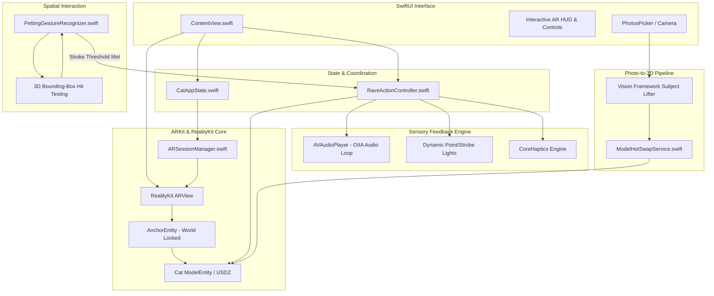

# 🐱 OIIACatAR — Development Roadmap

Bringing the iconic **OIIA OIIA** spinning cat meme to Augmented Reality with RealityKit, ARKit, Vision, and SwiftUI.

---

## 🗺️ Phase Overview

| Phase | Title | Key Modules / Scope | GitHub Tracking | Status |
| :---: | :--- | :--- | :---: | :---: |
| **Phase 1** | **AR Foundation & World-Locked Cat Placement** | `ARSessionManager.swift`, `CatAppState.swift`, plane detection, raycasting, USDZ anchoring | [#1](https://github.com/lgarbar/OIIACatAR/issues/1) | 🟡 Planned |
| **Phase 2** | **OIIA OIIA Levitation, Spin & Rave Engine** | `RaveActionController.swift`, `ContentView.swift`, 60/120fps spin, audio sync, rave lights, haptics | [#2](https://github.com/lgarbar/OIIACatAR/issues/2) | ⚪ Queued |
| **Phase 3** | **Photo-to-3D Pipeline** | Vision background removal (`VNGenerateForegroundInstanceMaskRequest`), Image-to-USDZ hot-swap | [#3](https://github.com/lgarbar/OIIACatAR/issues/3) | ⚪ Queued |
| **Phase 4** | **Gesture "Petting" Trigger** | `PettingGestureRecognizer.swift`, 3D bounding-box stroke recognizer, particle cues, auto-rave trigger | [#4](https://github.com/lgarbar/OIIACatAR/issues/4) | ⚪ Queued |

---

## 🏗️ System Architecture

---

## 📋 Detailed Phase Breakdown

### Phase 1: AR Foundation & World-Locked Cat Placement
> **Tracking Issue:** [#1](https://github.com/lgarbar/OIIACatAR/issues/1) &bull; **Label:** `phase-1`

#### Objectives
Establish the core Augmented Reality pipeline using RealityKit and ARKit, enabling reliable plane detection, surface raycasting, and stable world-locked placement of the 3D cat asset.

#### Architectural Components
- **`ARSessionManager.swift`**:
  - Encapsulate `ARSession` configuration using `ARWorldTrackingConfiguration`.
  - Enable horizontal plane detection (`planeDetection = [.horizontal]`).
  - Implement surface raycasting using `ARView.raycast(from:allowing:alignment:)` targeting existing plane geometry or estimated planes.
  - Manage AR tracking state transitions (`notAvailable`, `limited`, `normal`) and session interruptions / relocalizations.
- **`CatAppState.swift`**:
  - Central observable application state (`ObservableObject` or `@Observable`).
  - Track placement lifecycle: plane discovery status, cat placed status, camera tracking quality, and active anchor references.
  - Coordinate tap gesture raycasting with visual placement indicators.
- **Asset & Anchor Setup**:
  - Load the initial 3D cat model (`ModelEntity` / USDZ) with normalized scale (~20-25cm height).
  - Attach entity to a world-locked `AnchorEntity(world:)` facing the camera upon placement.

#### Technical Acceptance Criteria
- [ ] `ARSessionManager` initializes and runs `ARWorldTrackingConfiguration` with horizontal plane detection.
- [ ] UI reflects plane discovery status (surface scanning guide vs. surface ready).
- [ ] Tap-to-place gesture performs raycast against detected surface and instantiates a world-locked `AnchorEntity`.
- [ ] Cat model maintains world-locked position without drift or jitter during camera translation and rotation.
- [ ] ARKit tracking interruptions (app backgrounding, low light, rapid motion) recover cleanly via relocalization.
- [ ] Clear architectural separation between ARKit session callbacks and SwiftUI state.

---

### Phase 2: OIIA OIIA Levitation, Spin & Rave Engine
> **Tracking Issue:** [#2](https://github.com/lgarbar/OIIACatAR/issues/2) &bull; **Label:** `phase-2`

#### Objectives
Implement the signature viral meme mechanics: levitating the cat, spinning at high velocity around its vertical axis, looping the iconic "OIIA OIIA" soundtrack in perfect sync, pulsing dynamic rave lights, and delivering rhythmic haptics.

#### Architectural Components
- **`RaveActionController.swift`**:
  - State machine governing Rave mode states: `idle`, `ascending`, `raving`, `descending`.
  - **Levitation Animation**: Smooth upward translation (+0.25m to +0.35m relative to anchor plane) with quadratic easing.
  - **Spin Loop**: Continuous high-speed yaw rotation matching the tempo of the meme audio track without frame stutter (60fps/120fps ProMotion).
  - **Audio Synchronization**: Low-latency `AVAudioPlayer` playback configured for seamless, gapless looping of the iconic OIIA OIIA track, managing audio session activation and ducking.
  - **Dynamic Lighting**: Point/directional lights cycling through RGB hues and strobe pulses illuminating the cat and surrounding AR surfaces.
  - **Haptic Engine**: Rhythmic haptic pulses generated via `UIImpactFeedbackGenerator` or `CHHapticEngine` synchronized to the meme beat.
- **`ContentView.swift`**:
  - SwiftUI overlay containing the `ARViewContainer`, Rave toggle button, BPM visualizer/beat indicator, and reset/reposition controls.

#### Technical Acceptance Criteria
- [ ] Triggering Rave mode smoothly levitates the cat entity to target elevation.
- [ ] Cat continuously spins around its local vertical Y-axis at consistent velocity with zero stutter.
- [ ] "OIIA OIIA" meme audio plays synchronously with the spin start and loops seamlessly with zero latency gap.
- [ ] Dynamic AR lighting (rainbow/strobe point light) illuminates the cat and surrounding environment during Rave mode.
- [ ] Haptic feedback pulses rhythmically in sync with the audio beat.
- [ ] Exiting Rave mode smoothly descends the cat back to its resting surface anchor, halts rotation, and fades out audio.

---

### Phase 3: Photo-to-3D Pipeline
> **Tracking Issue:** [#3](https://github.com/lgarbar/OIIACatAR/issues/3) &bull; **Label:** `phase-3`

#### Objectives
Allow users to photograph or import their own cat, isolate the pet using Apple Vision framework subject lifting, generate a 3D RealityKit-compatible asset (`.usdz` / textured mesh), and hot-swap it onto the active world anchor in real time.

#### Architectural Components
- **Vision Background Removal (`VisionSubjectLifter.swift` / `BackgroundRemovalService.swift`)**:
  - Integrate Apple Vision framework's `VNGenerateForegroundInstanceMaskRequest` (iOS 17+).
  - Isolate the pet subject and generate a clean alpha-masked high-resolution PNG with anti-aliased matte edges.
- **Image-to-3D USDZ Pipeline (`ModelHotSwapService.swift` / `USDZGenerationService.swift`)**:
  - Convert isolated pet image into a RealityKit-renderable 3D asset (e.g. double-sided extruded cutout mesh / billboard with depth maps, photogrammetry session, or remote generative Image-to-3D API returning USDZ).
  - Generate PBR/unlit materials with correct transparency and normal maps.
- **Dynamic Entity Hot-Swapping**:
  - Replace the active `ModelEntity` on the world anchor in real-time without resetting the `ARSession` or losing tracking.
  - Preserve anchor transform, collision bounds, and compatibility with the Rave Engine (levitation + spin) and Gesture Recognizer.

#### Technical Acceptance Criteria
- [ ] User can pick a photo via `PhotosPicker` or capture directly from the camera.
- [ ] Vision framework segments the foreground subject with clean alpha mask.
- [ ] Pipeline generates a valid RealityKit-renderable 3D USDZ entity / textured mesh.
- [ ] `ModelHotSwapService` replaces the displayed cat on the world anchor without re-scanning or repositioning.
- [ ] Hot-swapped custom model seamlessly supports the levitation, spin, and lighting effects from Phase 2.
- [ ] Error handling for no subject detected, blurry image, memory limits, or model loading failures.

---

### Phase 4: Gesture "Petting" Trigger
> **Tracking Issue:** [#4](https://github.com/lgarbar/OIIACatAR/issues/4) &bull; **Label:** `phase-4`

#### Objectives
Create a tactile, spatial interaction system featuring a 3D bounding-box stroke recognizer that detects realistic "petting" motions on the cat model and automatically triggers the OIIA OIIA Rave mode upon reaching a petting threshold.

#### Architectural Components
- **`PettingGestureRecognizer.swift`**:
  - Custom gesture / continuous touch tracking on `ARView`.
  - Continuous raycasting / hit-testing against the cat entity's 3D oriented bounding box (OBB) and collision shape.
  - Stroke trajectory analyzer: evaluates stroke velocity, direction reversal (back-and-forth strokes), stroke count, and touch duration.
  - Rejection heuristics: distinguishes deliberate petting strokes from accidental taps, screen pans, or camera re-orientation.
- **Spatial Collision Setup**:
  - Attach tailored `CollisionComponent` and kinematic `PhysicsBodyComponent` to the cat entity.
  - Map touch contact points into cat local coordinates to verify strokes land on top/head regions.
- **Interactive Feedback & Rave Trigger**:
  - Micro-haptics (`UIImpactFeedbackGenerator(style: .light)`) on each stroke progression.
  - Visual particle emissions (hearts/sparks/purr ripples) at the 3D stroke contact point.
  - Accumulation threshold (e.g. 3 consecutive strokes within 2.5 seconds) triggers `RaveActionController.startRave()`.

#### Technical Acceptance Criteria
- [ ] 3D collision bounds accurately encompass the active cat model's volume.
- [ ] Drag/pan gestures over the cat entity are continuously tracked in 3D local coordinates.
- [ ] Stroke analyzer reliably detects back-and-forth petting motions based on velocity and direction reversal thresholds.
- [ ] Immediate interactive feedback: tactile micro-haptics and 3D visual particle cues during each petting stroke.
- [ ] Achieving the petting threshold smoothly activates the Phase 2 OIIA OIIA Rave mode.
- [ ] Gestures outside the bounding box or erratic multi-finger touches do not trigger accidental petting activations.

---

## 🛠️ Technology Stack

- **Platform:** iOS 17.0+
- **Languages:** Swift 5.9+ / Swift 6
- **AR Frameworks:** RealityKit 4, ARKit 6
- **Computer Vision:** Apple Vision Framework (`VNGenerateForegroundInstanceMaskRequest`), CoreML
- **Audio & Sensory:** AVFoundation (`AVAudioPlayer`), CoreHaptics
- **UI Framework:** SwiftUI, Combine
- **3D Formats:** Universal Scene Description (`.usdz`)
